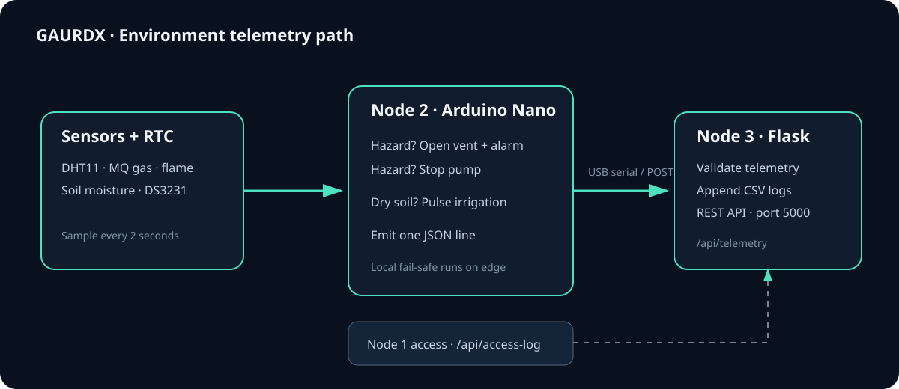
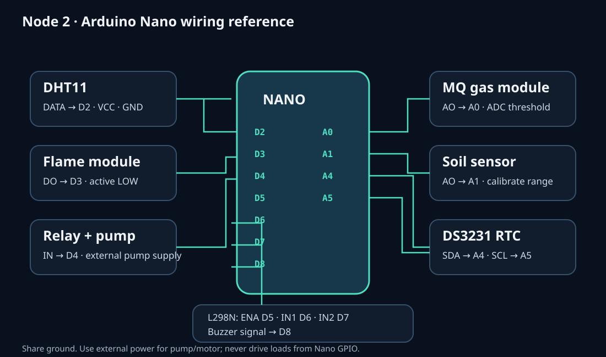

# GAURDX: AI-Integrated Security System

GAURDX combines three local nodes: access control (Node 1), environmental safety and automation (Node 2), and a local telemetry API (Node 3). The edge controller keeps hazard actions local so they do not depend on the server being available.

## System architecture



### Node 1: Access control (Arduino Uno)

The existing [`RFID_Node_1.ino`](RFID_Node_1.ino) reads an RC522 card and actuates the door servo for the authorized UID. The API accepts its documented `GET /api/access-log?uid=<hex>&status=SUCCESS` format. The sketch currently prints events to Serial; network transport through the ESP-01 is a separate hardware integration step.

### Node 2: Environment and automation (Arduino Nano)

[`Node_2/Environment_Node_2.ino`](Node_2/Environment_Node_2.ino) samples every two seconds and emits one JSON object per line at 9600 baud. A flame or gas threshold event opens the vent, sounds the buzzer, and stops the pump. Dry soil triggers a three-second pump pulse only when no hazard is active.



| Nano pin | Connection |
| --- | --- |
| D2 | DHT11 data |
| D3 | Flame module digital output (LOW means detected) |
| D4 | Pump relay input |
| D5 / D6 / D7 | L298N ENA / IN1 / IN2 for vent motor |
| D8 | Active buzzer signal |
| A0 | MQ gas module analog output |
| A1 | Soil moisture analog output |
| A4 / A5 | DS3231 SDA / SCL |

**Calibrate before operating hardware.** Set `GAS_ALARM_ADC`, `SOIL_DRY_PERCENT`, `RELAY_ACTIVE_LOW`, and `SOIL_DRY_IS_LOW` for the modules in use. MQ values are reported as `gas_adc` (0–1023), not ppm; ppm needs sensor-specific calibration. Verify flame polarity and relay polarity. Power the pump and motor from suitable external supplies, use a common ground, and do not drive loads from Nano GPIO. The L298N ENA jumper must be removed to use D5 PWM. Install the Arduino libraries `DHT sensor library` and `RTClib` before compiling.

### Node 3: Local API (Python / Flask)

[`Node_3/app.py`](Node_3/app.py) validates and records telemetry and access events in CSV files. Install Python 3.10 or newer, then run:

```sh
cd Node_3
python -m venv .venv
# Activate the virtual environment, then:
pip install -r requirements.txt
python app.py
```

The service listens on `127.0.0.1:5000` by default. Set `GAURDX_HOST=0.0.0.0` only when other devices on the trusted LAN need to connect. `GAURDX_DATA_DIR` can select a different log directory. CSV files are created on first write and are excluded from version control.

| Method and path | Purpose |
| --- | --- |
| `GET /health` | Service health |
| `POST /api/telemetry` | Validate and append Node 2 JSON payload |
| `GET /api/telemetry?limit=100` | Read up to 1,000 recent telemetry rows |
| `GET /api/access-log?uid=A3F1B290&status=SUCCESS` | Append a Node 1 access event |
| `POST /api/access-log` | Append `{ "uid": "A3F1B290", "status": "SUCCESS" }` |

Example Node 2 payload:

```json
{
  "timestamp": "2026-09-25 22:43:00",
  "temperature_c": 26.5,
  "humidity_pct": 58.0,
  "gas_adc": 120,
  "flame_detected": false,
  "soil_moisture_pct": 42,
  "pump_active": false,
  "vent_status": "CLOSED",
  "hazard_detected": false
}
```

`temperature_c` or `humidity_pct` may be `null` if the DHT11 misses a reading. The API records its own UTC `received_at` value as well as the device timestamp. To connect the Nano, leave the API running, set `GAURDX_SERIAL_PORT` to the Arduino port (for example `COM3`), and run `python serial_bridge.py` from `Node_3`. The bridge uses 9600 baud by default; `GAURDX_BAUD` and `GAURDX_API_URL` can override the defaults.

## Hardware and communication notes

- The Nano and Uno use 5V logic; ESP-01 and RC522 use 3.3V logic. Level-shift lines as required by the module datasheets.
- Keep high-current pump, motor, and servo power separate from microcontroller GPIO power.
- Node 2 sends JSON over USB Serial/UART; Node 1's documented server interface uses HTTP GET.
- The RTC timestamp has no timezone marker; set the RTC to the local convention you want to retain in logs.

## Future work

The local API and CSV data provide a foundation for dashboards, anomaly detection, and local model integration. No LLM or automated decision service is enabled by this implementation.

## License

See [LICENSE](LICENSE).
